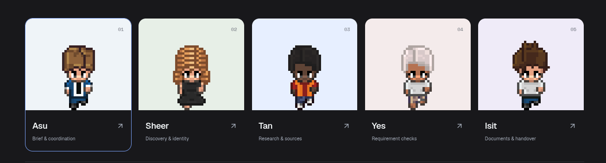
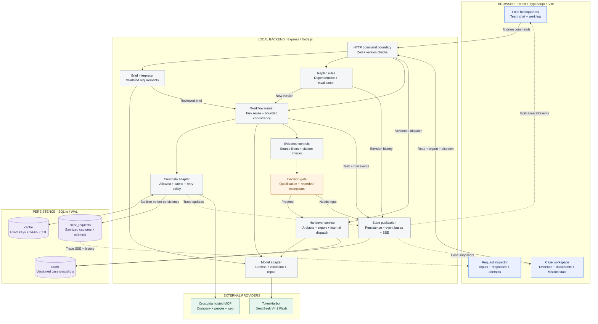
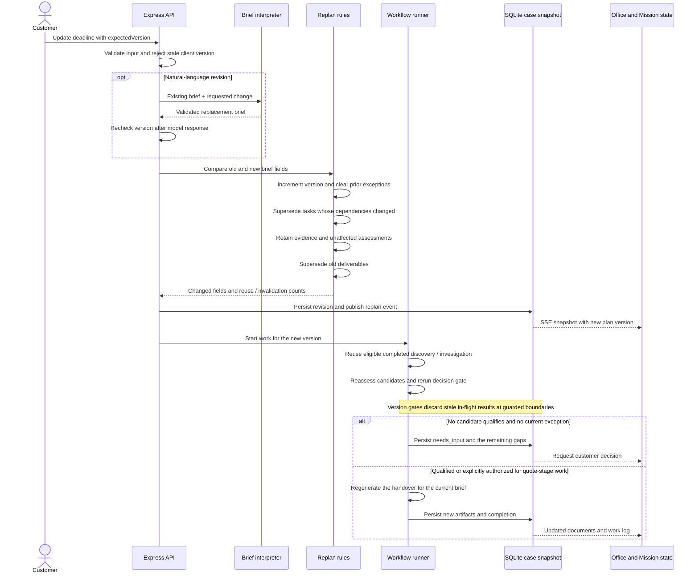
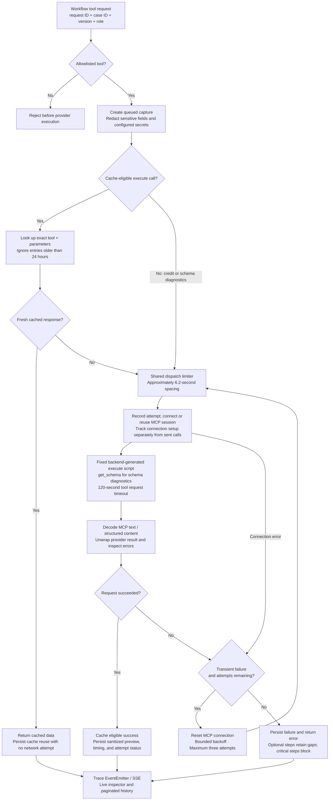

<div align="center">
  
  <h1>AfterHours</h1>
  <p><strong>Business doesn’t clock out. Meet your night shift.</strong></p>
  <p>Five specialist AI coworkers. One business emergency. A clear next move.</p>
  <p></p>
  <p>
    
    
    
    
  </p>
  <p><a href="#quick-start">Quick start</a> · <a href="#how-it-works">How it works</a> · <a href="#architecture">Architecture</a> · <a href="DEMO_GUIDE.md">Demo guide</a></p>
</div>

A supplier disappears. A launch partner pulls out. Your company needs outside security expertise. Suddenly, you’re coordinating searches, checking claims, and assembling a handover while the deadline keeps moving.

**AfterHours is an AI sourcing desk for that moment.** Give the team a rough brief and inspect the providers, evidence, unresolved questions, and documents it produces. Direct the work through a pixel office and team chat, with the actual workflow visible underneath.


*Headquarters and team chat during a completed local QA mission. The office reflects task state; off-duty movement and recreation are scripted.*

## What you get

- **A sourced shortlist** built from company records, professional context, and public web research.
- **Requirement-by-requirement checks** with reasons, citations, and explicit unknowns.
- **A usable handover** with a comparison, tailored quote-request drafts, and next steps.
- **Work that survives a changed brief**, with retained research and visible plan revisions.
- **An inspectable data trail** showing actual Crustdata inputs, response previews, attempts, and cache reuse.
- **Exportable files** and a persisted internal inbox that prevents duplicate delivery for the same case version.

The current service ends at sourcing preparation. AfterHours does not contact providers, confirm their availability, book services, spend money, or perform incident remediation. When no candidate clears the required checks, it asks for a decision before preparing a quote-stage package with the gaps recorded.

## How it works

1. **Describe the emergency.** Asu turns the request into an editable brief. Missing details stay open.
2. **Start the team.** Sheer discovers providers; Tan investigates their records and public work.
3. **Inspect the checks.** Yes assesses every requirement against candidate-specific evidence.
4. **Steer the plan.** Change the brief, exclude a provider, pause, resume, or resolve a decision.
5. **Take the handover.** Isit prepares the documents for review, export, or internal delivery.

### Meet the night shift

| Coworker | Responsibility | Working style |
| --- | --- | --- |
| **Asu** | Brief and coordination | Calm in the group chat |
| **Sheer** | Discovery and shortlist | Finds leads; checks first |
| **Tan** | Company, people, and web research | Brings the receipts |
| **Yes** | Evidence and requirement checks | Professionally unconvinced |
| **Isit** | Documents and handover | Makes it someone’s next step |

These are specialist roles within a bounded workflow, using one configured model and shared case state. Application code controls execution. Separate role prompts do not establish independent verification.

### Change the deadline without losing the research

Tasks declare which brief fields they depend on. A deadline-only revision preserves company research while reopening affected checks and deliverables. Broader changes can reopen discovery and investigation. Brief versions prevent stale work from being accepted into the current plan; superseded records remain inspectable.

Mission state exposes those dependencies, revisions, and task history. The team work log shows actual task and tool events.

### Follow the data request by request


*Actual captures from a local QA case. Counts describe that case, not a performance guarantee.*

Open **Crustdata** in headquarters to inspect:

- Request parameters and sanitized response previews.
- Tool owner, brief version, elapsed time, and attempt history.
- Workspace or mission scope, filters, search, and JSON export.
- Cache reuse counted separately from network attempts.

Captures persist across restarts. The pane records calls at the provider boundary; authentication handshakes and historical bodies from before capture began are not reconstructed. Response previews may be truncated.

## Quick start

Requires **Node.js 24.2+**, npm, a Crustdata API key, and a TokenHarbor API key.

```sh
git clone https://github.com/asucodes/afterhours.git
cd afterhours
npm install
cp .env.example .env.local
```

Set your keys locally in `.env.local`:

```dotenv
TOKENHARBOR_API_KEY=your_tokenharbor_key
CRUSTDATA_API_KEY=your_crustdata_key
TOKENHARBOR_MODEL=deepseek-v4.1-flash:free
```

```sh
npm run dev
```

Open [localhost:5173](http://127.0.0.1:5173). The API listens on port **3001**. Both bind to loopback.

| Route | What’s there |
| --- | --- |
| `/` | Product story and team |
| `/hq` | Headquarters, chat, case files, Mission state, and request audit |
| `/methodology` | Data flow, decision rules, and interactive replanning explanation |
| `/comic` | Six-panel fictional Firefox story, transcript, and editable demo brief |

For a production build served by Express:

```sh
npm run build
npm start
```

Then open [localhost:3001](http://127.0.0.1:3001). Cases, cache entries, and request captures are stored in ignored `data/afterhours.sqlite`. Keys remain server-side. This is a local prototype without production authentication or tenant isolation.

## Architecture

AfterHours combines a **versioned workflow**, **candidate-scoped evidence**, **bounded model steps**, and **persisted provider observability**. The office is the interface to that system. The diagrams below show the shipped implementation, including the paths taken when requirements change or a request fails.

### System map



**Solid arrows show execution or storage access. Dashed arrows show live observability.** These boxes are modules and tables in a single local backend, not separately deployed microservices. Required prompts and evidence are sent to the configured external providers; case storage stays local.

### The sourcing pipeline and its decision boundary

```mermaid
flowchart TB
    Request["Customer request"] --> Interpret["Asu: interpret and validate the brief<br/>Product · Geography · Capabilities · Deliverables<br/>Budget and deadline remain open when unspecified"]
    Interpret --> Review["Customer reviews the editable brief"]
    Review --> Start["Start the versioned mission"]
    Start --> Discover["Sheer: company_search<br/>Hybrid retrieval of actual company records"]
    Discover --> HasRows{"Usable company rows?"}
    HasRows -->|"No"| WebFallback["web_search_live fallback<br/>Extract providers tied to returned URLs"]
    HasRows -->|"Yes"| Select["Select up to three returned providers<br/>Exact-name mapping or visible fallback to real leads"]
    WebFallback --> Select

    subgraph CandidateWork["PER CANDIDATE · investigation followed by review · batches of two"]
        Identity["Tan: resolve missing company ID<br/>company_identify when needed"]
        Context["company_enrich + person_search<br/>Optional failures preserve coverage gaps"]
        Public["web_search_live + web_enrich_live<br/>Public work, source pages, and website fallback"]
        Sources["Filter and retain evidence<br/>Candidate ID · URL · Excerpt · Tool · Retrieval time<br/>Deduplicate identical candidate / URL / excerpt"]
        Assessment["Yes: assess each requirement<br/>Supported · Contradicted · Unknown"]
        Normalize["Normalize assessments in code<br/>Accept candidate-specific evidence IDs<br/>Missing citations become unknown<br/>Budget and availability require confirmation"]
        Identity --> Context --> Public --> Sources --> Assessment --> Normalize
    end

    Select --> Identity
    Normalize --> Qualifies{"Any non-rejected candidate<br/>clears required checks?"}
    Qualifies -->|"Yes"| Write["Isit: generate the current package<br/>Comparison · Tailored inquiries · Handover"]
    Qualifies -->|"No"| Handoff["needs_input<br/>Explain unresolved requirements"]
    Handoff -->|"Revise requirements"| Interpret
    Handoff -->|"Record quote-stage authorization"| Write
    Write --> Artifacts["Persist current-version artifacts<br/>Keep prior versions superseded"]
    Artifacts --> Export["Review Markdown / copy source / export ZIP"]
    Artifacts --> Dispatch["Explicit internal dispatch<br/>Delivery key = case ID + brief version"]
```



The model supplies interpretation and content; application code enforces task execution, version checks, citation membership, decision boundaries, and delivery. The five roles share one configured model. They are not independent factual verifiers. Public-source research does not confirm a supplier’s current capacity or a project-specific quote.

### What happens when the brief changes



For a deadline-only change, discovery and company investigation remain reusable while review and deliverables reopen. Product, capability, geography, or deliverable changes can reopen earlier tasks too. On backend restart, interrupted running cases restore paused and interrupted working tasks queue for resume. This is persisted task recovery, not a distributed job queue; an unsaved external read can be repeated after a crash.

### Inside a Crustdata request



Captures describe tool calls, not every HTTP packet or authentication handshake. Response previews are sanitized and capped at 16,000 characters. Failed connection setup is distinguishable from an actual sent tool call. TokenHarbor has a separate model adapter with bounded handling for selected HTTP failures, JSON parsing, Zod validation, and one structured-output repair round.

### Implementation map

| Responsibility | Implementation |
| --- | --- |
| API contracts, commands, ZIP export, and both SSE streams | [`server/index.ts`](server/index.ts) |
| Dependency-injected workflow, task lifecycle, role calls, and version gates | [`server/workflow.ts`](server/workflow.ts) |
| Field-level invalidation, candidate rejection, and delivery key | [`server/replan.ts`](server/replan.ts) |
| Brief normalization and requirement construction | [`server/brief.ts`](server/brief.ts) |
| Citation normalization, qualification, and commercial unknowns | [`server/decision.ts`](server/decision.ts) · [`shared/evidenceQuality.ts`](shared/evidenceQuality.ts) |
| Model endpoint, parsing, validation repair, and shared pacing | [`server/providers.ts`](server/providers.ts) |
| MCP execution, cache decisions, attempts, and reconnect policy | [`server/crustService.ts`](server/crustService.ts) |
| Credential redaction and bounded response previews | [`server/traceSafety.ts`](server/traceSafety.ts) |
| SQLite case snapshots, cache, request captures, and startup recovery | [`server/store.ts`](server/store.ts) · [`server/recovery.ts`](server/recovery.ts) |
| Event-derived chat progress, request inspection, and mission history | [`src/progress.ts`](src/progress.ts) · [`src/CrustdataPane.tsx`](src/CrustdataPane.tsx) · [`src/MissionState.tsx`](src/MissionState.tsx) |
| Spatial interface, collision-aware movement, and idle routines | [`src/OfficeMap.tsx`](src/OfficeMap.tsx) · [`src/officeWorld.ts`](src/officeWorld.ts) · [`src/ambient.ts`](src/ambient.ts) |

The deployment remains a single local application. Authentication, tenant isolation, distributed workers, supplier outreach, payment execution, and Watcher-triggered monitoring are future work, not hidden components of these diagrams.

### Crustdata integration

The backend connects to the hosted MCP server at `https://install.crustdata.com/mcp` using the official MCP SDK and Streamable HTTP. Fixed backend-generated scripts invoke allowlisted tools through `execute`; model-generated code is never executed. `get_schema` supports diagnostics.

| Tool | Use |
| --- | --- |
| `company_search` | Discover relevant providers |
| `company_identify` | Resolve a domain to a company ID when needed |
| `company_enrich` | Retrieve exact company context |
| `person_search` | Find limited professional context associated with a company |
| `web_search_live` | Find public work and supporting sources |
| `web_enrich_live` | Retrieve candidate website content |
| `account_credits` | Inspect the account balance during diagnostics |

Exact tool-and-parameter responses are cached for **24 hours**. Actual dispatch is conservatively spaced by approximately **6.2 seconds**. Transient failures retry with connection reset; terminal authentication errors stop. Not every case needs every tool.

### Model and storage

- **TokenHarbor Chat Completions** runs the configured DeepSeek model. The default is `deepseek-v4.1-flash:free`, with no automatic paid fallback.
- **Zod** validates API inputs and structured model output, with bounded repair feedback.
- **SQLite in WAL mode** persists cases, cached responses, and request traces.
- **SSE** streams case and audit snapshots to the browser.
- **React Markdown and remark-gfm** render chat and documents; **JSZip** packages exports.

For the implementation walkthrough and handoff notes, see [BUILD_GUIDE.md](BUILD_GUIDE.md).

## Reliability and evidence

| Situation | Behavior |
| --- | --- |
| The brief changes | Version the plan, retain evidence, reopen dependent work |
| A result arrives for an old brief | Reject it as stale at workflow version gates |
| The backend restarts during work | Restore the case paused and queue interrupted tasks for resume |
| A source is empty, a redirect, or a recognizable challenge page | Exclude it from new checks; retain historical records for audit |
| A conclusion lacks valid candidate-specific citations | Normalize the check to unknown |
| Availability or a scoped price is requested | Leave it unknown without supplier confirmation |
| No provider clears the requirements | Request an explicit customer decision |
| Internal dispatch is repeated | Return the existing inbox item for that case version |

Grounding controls reduce failure modes; they do not guarantee factual correctness or semantic entailment. The internal inbox guarantee does not imply exactly-once external execution. A crash can repeat a read, and creating a new case has no general idempotency key.

## Validation

```sh
npm test
npm run build
```

The latest validation passed **53 automated tests** and the production build. Coverage includes the actual workflow factory with deterministic providers, targeted replanning, citation normalization, recovery, retry behavior, dispatch idempotency, and office movement.

Live QA separately exercised sourcing, cache reuse, package creation, completed-case rejection, and repeated internal dispatch. Fresh research and model calls can exceed a two-minute demo slot. Use clearly labeled saved runs when presenting; see [DEMO_GUIDE.md](DEMO_GUIDE.md) for recorded timings and the demo sequence.

<details>
<summary><strong>Optional live provider checks</strong></summary>

```sh
npm run check:providers
npm run check:providers -- --research
```

The first makes a small model request and reads the Crustdata balance. The research option also runs a three-result company search and consumes Crustdata credits. These checks require your local keys.

</details>

<details>
<summary><strong>The night shift in six panels</strong></summary>


Firefox is an illustrative parody client, not a customer or partner. The comic explains specialist sourcing and coordination; it does not depict cryptographic remediation. Open `/comic` locally for the transcript and editable unsent brief.

</details>

## Roadmap

- Ingest actual supplier replies and scoped quotes.
- Confirm availability using returned evidence.
- Strengthen evidence entailment checks and evaluations.
- Add authentication, tenant isolation, and durable background jobs for a shared deployment.
- Explore Crustdata Watchers for relevant company or contact changes.

These are future work, not shipped integrations.

## Credits

Built for **ContextCon 04 at IIT Kanpur**, around the theme **Services, Replaced**.

Office furniture, textures, and character sprites are reused from [Pixel Agents](https://github.com/pixel-agents-hq/pixel-agents), with its MIT license retained. Character artwork is credited to JIK-A-4’s MetroCity pack under CC0. See [THIRD_PARTY.md](THIRD_PARTY.md) for attribution and design references.
